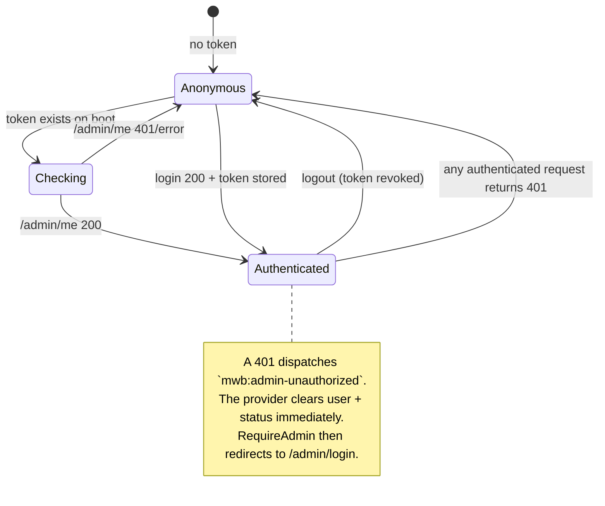
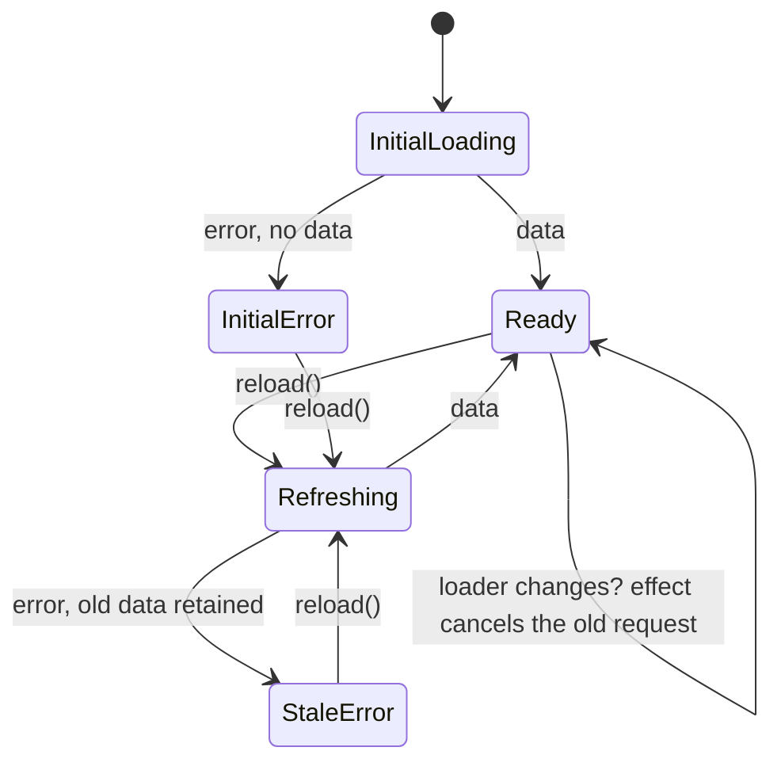
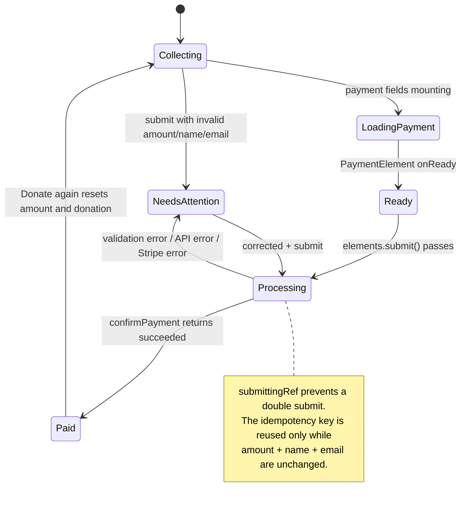
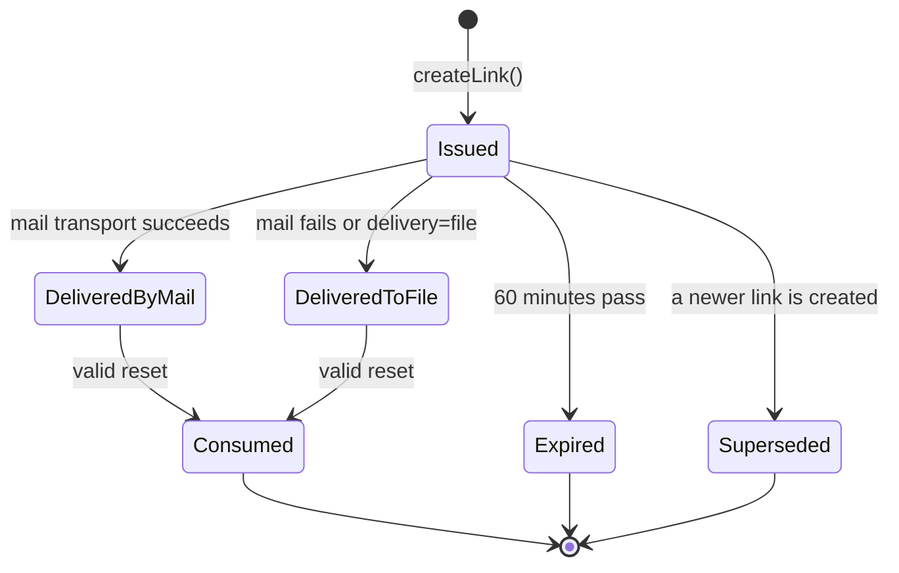
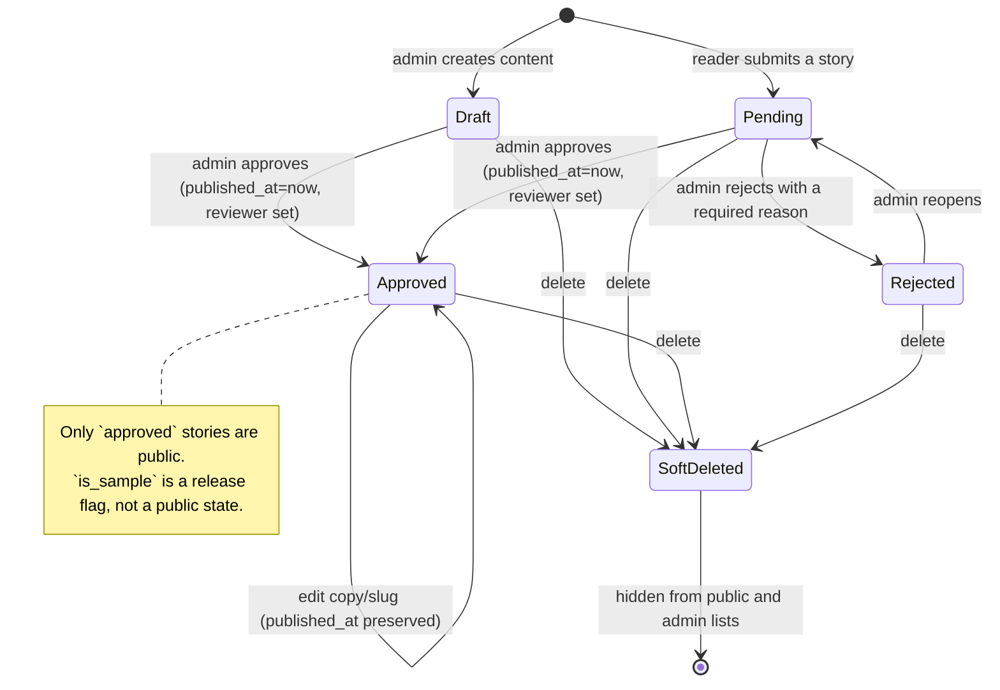
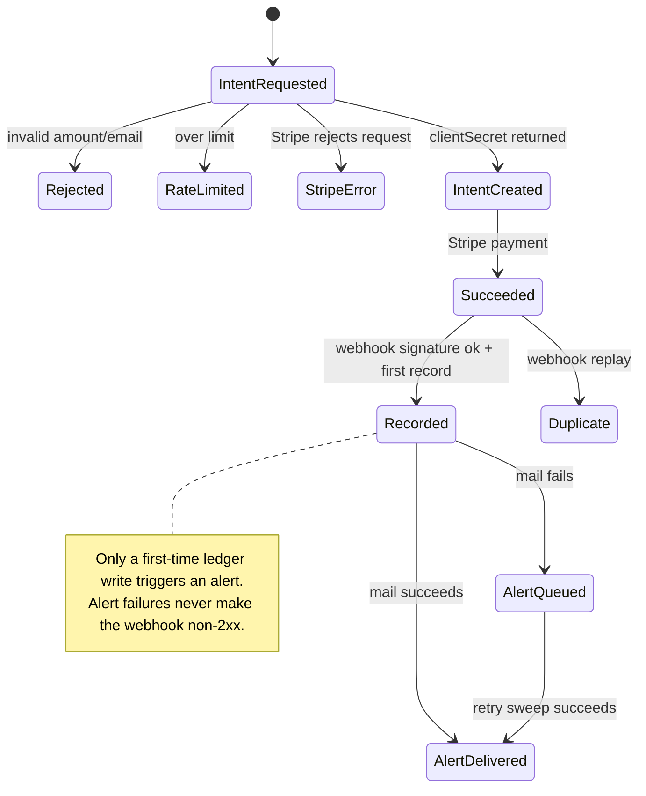
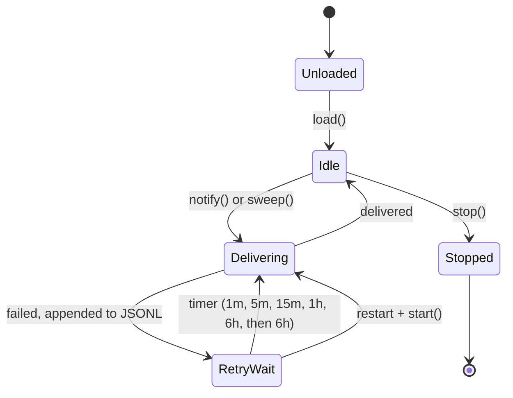
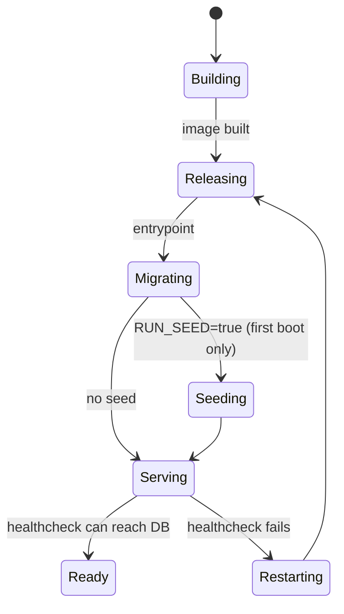

# State machines and invariants

This document is the map of every place in Music Without Borders where the UI or
API behaves as a state machine. Most of these were implicit before this pass:
they were boolean flags or a combination of `loading`, `error`, and `data`.
The goal is not to replace React state with a library. The goal is to make the
states **nameable, observable, and hard to break**.

Last reviewed: 2026-11-17.

---

## 1. The state contract

### UI attributes

These attributes are deliberately public. Tests, accessibility tooling, and
agents can use them without reading component internals.

| Attribute | Values | Where |
| --- | --- | --- |
| `data-theme` on `<html>` | `light`, `dark` | `index.html`, `src/lib/theme.ts` |
| `data-state` on page states | `loading`, `error`, `empty`, `ready` | `src/components/cms/PageState.tsx`, list/detail pages |
| `data-state` on the admin guard | `checking-session` | `RequireAdmin` in `src/lib/adminAuth.tsx` |
| `data-state` on the mobile menu | `open`, `closed` | `src/components/Navbar.tsx` |
| `data-state` on the checkout panel | `unconfigured`, `collecting`, `processing`, `paid` | `src/pages/Donate.tsx` |
| `data-state` on the checkout form | `loading-payment`, `ready`, `needs-attention`, `processing` | `src/components/CheckoutForm.tsx` |
| `data-active-tab` on the admin shell | `overview`, `home`, `about`, `performances`, `testimonials`, `stories`, `settings` | `src/pages/AdminDashboard.tsx` |

Use lower-kebab-case values. A surface must expose exactly one `data-state` at a
time. Do not use `data-state` for editorial status (published, draft, sample);
those live in the API and in visible badges.

### API health

| Endpoint | Reports | Does **not** report |
| --- | --- | --- |
| `GET /api/health` | API process up and MySQL reachable | route-level readiness, mail |
| `GET /health` on the donation service | currency/limits, ledger present, webhook secret present, mail queue configured, pending alert count | Stripe key validity, mailbox deliverability |

`mail: true` means an alert transport is configured, not that a message has been
delivered. Use `npm run check-mail` in `server/` for a real transport check.

---

## 2. Inventory

### Public UI

| ID | Where | States | Persistence / notes |
| --- | --- | --- | --- |
| UI-01 | Theme toggle (`ThemeToggle`, `theme.ts`, inline boot script) | `light`, `dark` | `localStorage["mwb-theme"]`; invalid/missing falls back to `dark`; no system-preference state; no cross-tab listener |
| UI-02 | Mobile navigation (`Navbar`) | `closed`, `open` | Open on button; close on button, route change, or Escape; focus returns to the toggle; `inert` while closed |
| UI-03 | Site settings (`SiteSettingsProvider`) | hydrating, ready, fallback | Starts with seeded defaults, merges remote values; an API failure silently keeps defaults; no error surface by design |
| UI-04 | Shared content loader (`usePageContent`) | initial-loading, refreshing, ready, initial-error, stale-error | Keeps previous data during a retry; `reload()` clears the error; cancellation flag prevents late writes |
| UI-05 | Performances index (`IndexPage`) | loading, error, empty, empty-filtered, ready | `selectedType` + `searchQuery` are derived filters; not in the URL; `data-state` reflects the result |
| UI-06 | Performance detail (`DetailPage`) | loading, ready, error/not-found | Guards against stale records when the route id changes; no retry button |
| UI-07 | Stories index (`Stories`) | loading, error, empty, ready | Uses `usePageContent`; a stale error is hidden if old data exists |
| UI-08 | Story detail (`StoryDetail`) | loading, error/not-found, ready | Any error with no data is presented as "not found", including a network failure |
| UI-20 | Donation amount (`Donate`, `CheckoutForm`) | empty, invalid, valid-preset, valid-custom | `amountText` is the source; `parseDonationAmount` decides validity; presets write into the same field |
| UI-21 | Stripe payment fields (`Elements`, `PaymentElement`) | mounting, ready, validation-error, submitting, read-only | Deferred-intent mode; `Elements` is rebuilt when the theme changes, not while processing |
| UI-22 | Checkout submission (`CheckoutForm`) | idle, validating, processing, needs-attention, paid | Refs guard double-submit; idempotency key is reused until amount/name/email change; 20 s request timeout |
| UI-23 | Receipt dialog (`DonationSuccessDialog`) | closed, open, copy-idle, copy-copied, copy-failed | Focus is restored manually because the submit button unmounts on success |
| UI-24 | Route redirects (`App.tsx`) | redirecting, not-found, rendered | `/blog` → `/stories`; `/faq` is intentionally not a route; unknown paths render the 404 page |

### CMS UI

| ID | Where | States | Persistence / notes |
| --- | --- | --- | --- |
| UI-09 | Admin session (`AdminAuthProvider`) | anonymous, checking (`loading`), authenticated | Token in `localStorage["mwb-admin-token"]`; bootstrap calls `/admin/me`; a 401 from any authenticated request clears the token and emits `mwb:admin-unauthorized` |
| UI-10 | Login form (`AdminAuth`) | idle, submitting, error, success | Successful login updates the provider, then navigates to the page the guard remembered |
| UI-11 | Forgot-password form | idle, submitting, generic-success, error | Always shows the same success copy so the endpoint cannot enumerate admins |
| UI-12 | Reset-password form | idle, submitting, success, expired/invalid, error | Token/signature/expiry come from the URL; success revokes every existing admin token |
| UI-13 | `RequireAdmin` guard | checking, redirect-to-login, render-children | `state.from` records the pathname for post-login return |
| UI-14 | Dashboard tabs | one of seven tabs | **URL is now the source of truth** (`/admin?tab=stories`); invalid values fall back to `overview`; tab changes use `replace` |
| UI-15 | Page editor (`PageEditor`) | loading, ready, initial-error, notice, refreshing | Optimistic section/item reorder; a failed reorder sets an error and reloads; reload remounts child editors via `key={version}` |
| UI-16 | Section/item editors (`SectionEditor`, `ItemEditor`) | collapsed, expanded, editing, saving, saved, error | Local drafts; a parent reload discards unsaved drafts; native `
` disclosure |
| UI-17 | Record manager (`RecordManager`) | loading, empty, ready, creating, editing, saving, deleting, notice, error | One `busy` flag covers create/update/delete; delete uses `window.confirm`; list refresh is disabled only while loading |
| UI-18 | Settings editor | loading, ready, filtered-empty, saving, saved, error | No dirty state: `Refresh` overwrites unsaved edits without a prompt |
| UI-19 | Overview counters | loading, partial, ready | `Promise.allSettled`; failed counters are omitted silently; no error state |

### API and runtime

| ID | Where | States | Persistence / notes |
| --- | --- | --- | --- |
| API-01 | Admin token lifecycle (`AdminAuthController`, Sanctum) | absent, active, expired, revoked | 8-hour expiration (`SANCTUM_EXPIRATION=480`); logout revokes the current token; password reset revokes all tokens; bearer token in browser storage |
| API-02 | Password reset link (`AdminPasswordResetService`) | issued, delivered-by-mail, delivered-to-file, validated, consumed, expired, superseded | Raw token never stored; SHA-256 hash + HMAC signature; 60 minutes; single use; mail failure falls back to private storage |
| API-03 | Admin authorization (`admin` middleware) | allowed, unauthenticated, forbidden | `auth:sanctum` + `is_admin`; 401/403 JSON |
| API-04 | Story publication (`Story`) | draft, pending, approved, rejected, soft-deleted | Single `status` source of truth; `published_at` is set on approval and cleared on rejection; public reads use `approved()` only; slugs are unique including trashed rows |
| API-05 | CMS visibility/order (`PageContentController`) | visible/hidden, ordered, reordered | `is_visible` filters public output; `sort_order` is 1-based and rewritten from the posted id array; reorder is not wrapped in a transaction and is not scoped per section for items |
| API-06 | PaymentIntent creation (`POST /create-payment-intent`) | valid, invalid, rate-limited, Stripe-error, created | In-memory fixed-window rate limiter (30/min per IP by default); optional `Idempotency-Key`; Stripe errors become 502 |
| API-07 | Stripe webhook (`POST /stripe-webhook`) | unconfigured, bad-signature, ignored-event, recorded, duplicate, record-failed, alert-queued | Raw body before JSON; only `payment_intent.succeeded` is handled; record failure returns 500 so Stripe retries; alert failure never fails the webhook |
| API-08 | Donation ledger (`createDonationStore`) | empty, loaded, appended, duplicate, write-error | Append-only JSONL; in-memory Set of PaymentIntent ids; writes serialised through a promise chain; duplicate returns `false` |
| API-09 | Alert queue (`createAlertQueue`) | unloaded, idle, delivering, delivered, queued, retry-wait, stopped | JSONL + backoff `[1m, 5m, 15m, 1h, 6h]`; retries on start; `notify()` never throws; a failed queue write leaves the alert in memory only |
| API-10 | Mail transport selection (`mailer.js`, Laravel `mail.php`) | unconfigured, Brevo API, Gmail, SMTP relay | Brevo HTTPS API is preferred when `BREVO_API_KEY` is set; Railway blocks outbound SMTP, so SMTP is a local/self-hosted fallback only |
| API-11 | CORS (`createApp`) | allowed, blocked | Allows same-origin/no-Origin, loopback, and configured `CORS_ORIGINS`; blocked origins get 403 JSON |
| API-12 | Readiness (`HealthController`) | ready, database-error | API health opens a PDO connection; a database failure is not a 200 |
| OPS-01 | Container boot (`entrypoint.sh`) | config-cache, route-cache, migrated, optional-seeded, serving | Migrations run on every boot; `RUN_SEED=true` is a one-time switch and must be removed after the first boot |

---

## 3. Detailed transitions

### 3.1 Admin session and route guard (UI-09, UI-10, UI-13, API-01)

Invariants:

- `status === "authenticated"` implies `user !== null`.
- `status === "anonymous"` implies no usable token is intentionally retained.
- The guard never renders admin children while `status === "loading"`.
- A failed sign-in (`auth: false`) must not emit the unauthorized event; the
  event is only for an existing session that ended.

### 3.2 Shared page loading (UI-04, UI-05, UI-07, UI-08)

Rules:

- A reload clears `error` but keeps `data`; this avoids a blank page on retry.
- The cancellation flag is the only guard against a late response overwriting a
  newer one. Do not remove it.
- "Empty" is a presentation decision, not a hook state. A page decides whether
  an empty array is an empty state or a valid list.

### 3.3 Checkout (UI-20 → UI-23)

Rules:

- `paid` is the only state that may render the receipt.
- `processing` must disable the submit control and mark the payment fields
  read-only.
- The donation receipt amount is read back from Stripe, never from the form.
- A failed payment must not reset the form; the donor must be able to retry.

### 3.4 Password reset (API-02)

Validation order is part of the contract:

1. HMAC signature matches.
2. Signed expiry is in the future.
3. Database hash matches the raw token.
4. Database expiry is in the future.
5. The user still exists and is an admin.

Only then is the password updated, every token revoked, and the reset row
deleted. Never log the raw link; only the exception class is logged.

### 3.5 Story publication and moderation (API-04)

Public read endpoints must only use `approved()`; admin reads may see every status.
Pending, rejected, and draft stories return 404 on the public detail route.
All moderation actions (submitted, approved, rejected, reopened) are recorded in `story_moderation_events`.
At most one story can have `is_featured = true` at any time, and only approved stories can be featured.
Each story has a unique immutable reference tracking code (`MWB-` + 8 uppercase alphanumeric characters). Authors track submission status via `GET /api/stories/status/{code}`, which returns strictly non-sensitive review state (`reference_code`, `title`, `status`, `category`, timestamps, and polite rejection reason only if rejected), with zero author email, story body, reviewer identity, or audit events exposed.
Each story belongs to one of four fixed categories (`community`, `concert`, `rehearsal`, `lending-library`). The public endpoint supports optional `?category=` filtering, and the frontend `/stories` directory provides instant category tabs with live story counts.
Slug uniqueness includes soft-deleted rows, so a deleted slug cannot be reused.

### 3.6 Donation pipeline (API-06 → API-09)

Rules:

- The PaymentIntent id is the ledger's idempotency key.
- A ledger write failure returns 500 so Stripe retries; a duplicate returns 200.
- An alert failure must not cause a 500 after the ledger write; otherwise Stripe
  replays an event the ledger then discards and the alert could be lost.
- `Idempotency-Key` protects the browser-to-API retry path; the ledger protects
  the Stripe-to-webhook retry path. They are separate guarantees.

### 3.7 Alert queue (API-09)

The queue is intentionally at-least-once. A crash after delivery but before the
queue file is rewritten can resend an alert. That is preferable to losing one.

### 3.8 Boot and readiness (OPS-01, API-12)

Migrations are idempotent. Seeding is not: run it once, then remove
`RUN_SEED` so CMS edits are never overwritten.

---

## 4. Invariants

1. **One source of truth per surface.** Theme: `data-theme`. Admin tab: URL.
   CMS content: API. Checkout amount: `amountText`. Receipt amount: Stripe.
2. **No impossible combinations.** Authenticated ⇒ user exists. Paid ⇒ receipt.
   Processing ⇒ submit disabled. Published story ⇒ `published_at` set.
3. **Never show a credential.** Reset links are emailed or written to private
   storage; passwords, API keys, SMTP secrets, and bearer tokens never appear in
   logs, error messages, or the repository.
4. **Retries are idempotent.** PaymentIntent creation uses `Idempotency-Key`;
   the ledger dedupes by PaymentIntent id; the alert queue is at-least-once.
5. **Public reads filter.** Stories use `published()`. Sections/items use
   `is_visible`. Soft-deleted records never appear on public endpoints.
6. **Alert failure is not payment failure.** The ledger write is the commit
   point; mail is a side effect that is queued and retried.

---

## 5. Gaps and recommended decisions

| Priority | Gap | Why it matters | Recommendation |
| --- | --- | --- | --- |
| P1 | `PageEditor` reorder has no in-flight guard; rapid clicks can interleave requests. The server reorder loop is not transactional. | The visible order can disagree with the database, and a partial failure leaves a mixed order. | Add a per-page `reordering` state that disables the arrows, and wrap the server reorder in `DB::transaction`. Validate that posted ids belong to the page/section. |
| P1 | `SettingsAdmin` has no dirty state; `Refresh` overwrites unsaved edits without a prompt. | An editor can lose a long settings edit. | Track `dirty` by comparing the loaded snapshot; disable/confirm Refresh when dirty. |
| P1 | `StoryDetail` maps every initial error to "not found". | A network outage looks like an unpublished story. | Add an `ApiError` with `status`; show "not found" only for 404 and a retry state for 5xx/network. |
| P2 | Admin token expiry is only noticed on the next authenticated request. | A user can sit on a stale dashboard until they click something. | Optional: schedule a timer for the 8-hour expiry, or call `/admin/me` on visibility change. The 401 event is the safety net. |
| P2 | Health `mail: true` means "configured", not "deliverable". | A bad Brevo key still reports healthy. | Have the donation service call `mailer.verify()` at startup (or expose `mailVerified`), and run `check-mail` in UAT. |
| P2 | Rate limiting is in-memory and per instance. | Multiple API replicas multiply the effective limit; a restart resets it. | Move to a shared store (Redis/DB) before scaling horizontally. |
| P2 | Password-reset link file remains after a successful reset. | A stale raw link stays on the volume. | Delete `admin-reset-link.txt` after a successful reset, and on link reissue. |
| P2 | Settings/overview failures are silent. | Editors cannot tell a partial load from a complete one. | Surface a non-blocking "some counters failed" notice; keep the last good values. |
| P3 | Theme does not sync across tabs; no system option. | Two tabs can disagree until reload. | Add a `storage` listener and, if desired, a tri-state `light/dark/system` model. |
| P3 | Performance filters are not preserved in the URL. | Back/forward and shared links lose the filter. | Store `type` and `q` in search params; keep the current derived filtering. |
| P3 | Page loaders have no retry/backoff or timeout. | A stalled API can leave a skeleton indefinitely. | Add an abortable timeout to `usePageContent`; keep manual retry. |
| P3 | Overview counters use `Promise.allSettled` without a loading/error state. | The page can look empty while data is arriving. | Add a small skeleton and a "could not load N counters" line. |

Already addressed in this pass:

- A footer **Staff login** link now reaches `/admin/login` from every public page.
- `mwb:admin-unauthorized` turns an expired/revoked session into a clean
  redirect instead of a dashboard full of failed requests.
- Admin tabs are URL-addressable and survive refresh.
- Public and admin state surfaces expose `data-state` / `data-active-tab`.
- The performances page uses the shared `usePageContent` loader instead of a
  second copy of the load logic.
- Brevo's HTTPS API is now a first-class mail transport in both services,
  because Railway blocks outbound SMTP.

---

## 6. Agent experience (AX) recipes

| Goal | Deterministic check |
| --- | --- |
| Staff entry point exists | From `/`, click `footer >> text=Staff login`; expect `/admin/login` and the `Welcome back to the bandstand` heading. |
| Admin tab deep link | Authenticate, then open `/admin?tab=stories`; expect `[data-active-tab="stories"]` and the Stories heading. |
| Expired session | Set `localStorage["mwb-admin-token"]` to a fake token and return 401 from `/api/admin/me` or any admin call; expect `/admin/login`. |
| Public load state | Open `/stories`; assert `[data-state="loading"]`, then `[data-state="ready"]` or `[data-state="empty"]`. |
| Checkout state | On `/donate`, assert the panel moves `collecting` → `processing` → `paid`; the form moves `loading-payment` → `ready` → `processing` → `needs-attention` on a validation error. |
| Donation health | `GET /health` → `ledger`, `webhooks`, `mail`, `pendingAlerts`; run `npm run check-mail` for a real login check. |
| Mail without SMTP | Set `BREVO_API_KEY` in both services; `check-mail` should list `Brevo API` first. Railway blocks ports 25/465/587/2525, so do not diagnose mail as an SMTP credential problem there. |

---

## 7. Developer experience (DX) notes

- `usePageContent` is the read-side pattern. New public pages should use it
  instead of hand-rolling `loading`/`error`/`data` state.
- Admin editors intentionally use local drafts so a failed save does not move
  the public page. If you add a new editor, include `busy`, `error`, and
  `notice` states and disable the submit button while `busy`.
- The checkout state is currently expressed as booleans plus refs. It is safe,
  but if it grows further, extract a `CheckoutState` union and a reducer in
  `src/lib/checkout.ts`; keep the `data-state` values identical.
- Theme values are duplicated in `index.html` and `src/lib/theme.ts` because the
  boot script must run before modules. Change both together.
- The donation ledger and alert queue are append-only/at-least-once by design.
  Do not "fix" a duplicate alert by deleting the ledger line; fix the delivery
  idempotency instead.
- When adding a new surface with asynchronous work, give it one of the
  documented `data-state` values and a test that asserts the transitions.

---

## 8. Change log

| Date | Change |
| --- | --- |
| 2026-11-17 | Added the state inventory, UI state contract, auth-expiry event, URL-addressable admin tabs, footer staff login, and Brevo API transport. |
